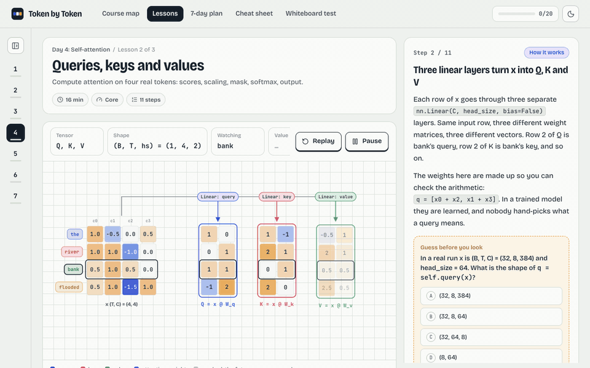
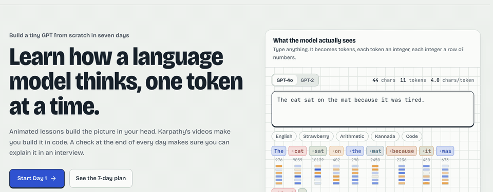
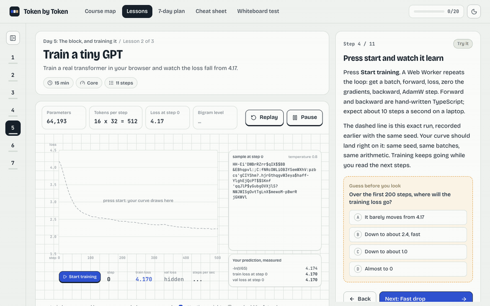
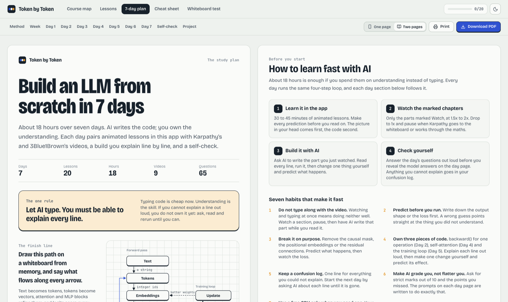
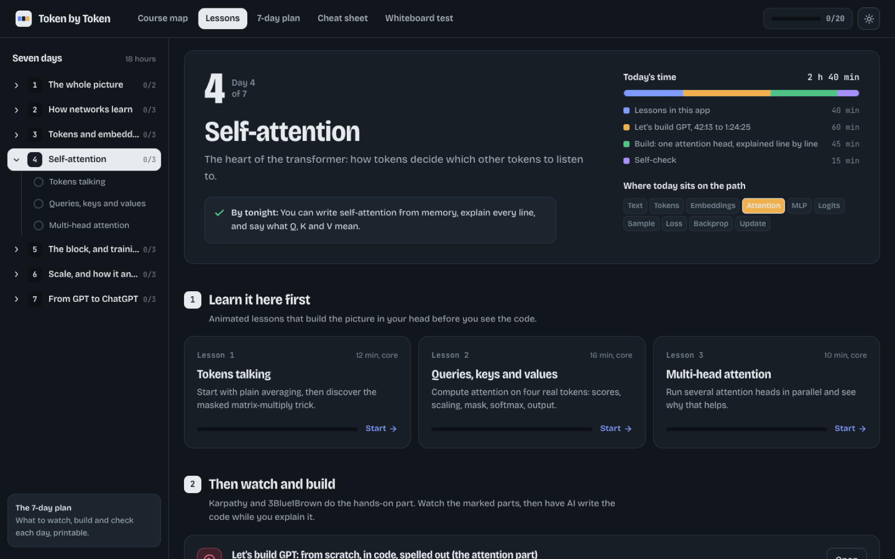

<div align="center">


# Token by Token

**Build an LLM from scratch in 7 days.**<br>
Animated lessons that show what happens inside a language model, one token at a time.

[](https://github.com/sushanshetty1/token-by-token/actions/workflows/ci.yml)


**[Open the course →](https://llm.sushans.dev)**<br><br>
[Quick start](#quick-start) · [The seven days](#the-seven-days) · [How it works](#how-it-works) · [Write a lesson](docs/authoring.md) · [Contribute](CONTRIBUTING.md)



</div>

## Why this exists

Most LLM explainers stop at a diagram. Most build-it-yourself courses bury the idea under the code. Token by Token does both, in that order:

1. **See it.** 20 animated lessons replay every step of a GPT on real numbers: tokens, embeddings, attention scores, the residual stream, the loss.
2. **Build it.** Each day points at the exact chapters of Andrej Karpathy's *Zero to Hero* and 3Blue1Brown's deep learning series to watch, skim or skip, and what to build with an AI assistant.
3. **Say it.** Every day ends with interview questions and model answers, so you can explain each line out loud.

The finish line is the whiteboard test: draw the whole path from memory and say what flows along every arrow.

```
text → tokens → embeddings → attention + MLP blocks → logits → loss → backprop → updated weights
```

## What is inside

<table>
<tr>
<td width="50%" valign="top">

**A real tokenizer in the browser.** Type anything and watch GPT-4o or GPT-2 cut it into tokens, with every id. Try "strawberry", arithmetic, code, or Kannada to see where tokenization breaks.



</td>
<td width="50%" valign="top">

**A GPT that trains on your laptop.** Day 5 trains a 64k-parameter character-level transformer on Shakespeare in a Web Worker. The forward and backward passes are hand-written TypeScript, checked against numerical gradients.



</td>
</tr>
<tr>
<td width="50%" valign="top">

**A printable 7-day plan.** The study plan is a page and an A4 PDF, shown as two-page spreads on wide screens, with checklists that sync with the day pages.



</td>
<td width="50%" valign="top">

**Light and dark, desktop and phone.** One graph-paper design system in both themes. Progress stays in your browser, with no account.



</td>
</tr>
</table>

Every lesson can also be read as plain text, which is how search engines and screen readers get the whole thing.

## Quick start

You need [Bun](https://bun.sh) 1.3+ and Node 22+.

```bash
git clone https://github.com/sushanshetty1/token-by-token.git
cd token-by-token
bun install
bun run dev -- --port 3140
```

Open http://localhost:3140. To build the static site:

```bash
NEXT_PUBLIC_SITE_URL=https://your-domain.example bun run build   # writes out/
bun run serve                                                     # http://localhost:3150
```

`out/` is plain HTML, CSS and JS, so it runs on any static host. See [docs/deploying.md](docs/deploying.md).

## The seven days

About 18 hours in all, two to three hours a day. Every day runs the same loop: learn it in the app, watch the marked chapters, build it with AI while you explain each line, then check yourself out loud.

| Day | Theme | Lessons | You can then |
| :-: | --- | --- | --- |
| 1 | The whole picture | A prompt's journey · One token at a time | Trace a prompt from keyboard to first word of the reply |
| 2 | How networks learn | Derivatives on a graph · Backprop, node by node · The training loop | Push gradients backwards by hand |
| 3 | Tokens and embeddings | Tokenization with BPE · Embeddings and positions · A bigram model and its loss | Read cross-entropy loss like a pro |
| 4 | Self-attention | Tokens talking · Queries, keys and values · Multi-head attention | Compute attention on four real tokens |
| 5 | The block, and training it | Anatomy of a block · Train a tiny GPT · Break it on purpose | Train a GPT and explain every curve |
| 6 | Scale, and how it answers you | Counting GPT-2's parameters · Training at scale · How the model answers you | Count 124M parameters, explain the KV cache |
| 7 | From GPT to ChatGPT | From GPT to ChatGPT · What changed since GPT-2 · The whiteboard test | Pass the whiteboard test |

Beyond the original *Zero to Hero* path, it covers inference (prefill and decode, the KV cache, sampling), what changed since GPT-2 (RoPE, RMSNorm, SwiGLU, grouped-query attention, mixture of experts), napkin math, and a timed interview drill. It ends with a mini project: train your own small GPT on text you care about and write it up.

## How it works

Each lesson is a module with 7 to 11 steps and one `Stage` that redraws a 960 × 540 SVG scene for every step. Steps carry a kind (intuition, problem, mechanism, insight, try, recap), a short body, an optional "guess before you look" question, highlighted lines of real PyTorch code, and live readings in the rail above the stage.

```
app/                    routes: course map, /day/<n>/, /day/<n>/<lesson>/, /plan/, /cheatsheet/,
                        plus sitemap, robots, manifest and llms.txt
content/
  curriculum.ts         the seven days, in order
  lessons.ts            lazy loaders for every lesson module
  day-<n>/day.ts        a day as data: schedule, videos and chapters, build, experiments, questions
  day-<n>/<slug>/       one lesson: index.tsx (steps), Stage.tsx (the scene), code.ts
components/
  player/               lesson player, stepper, code dock, text transcript
  viz/                  SVG primitives and controls every stage is drawn with
  day/ home/ shell/     page sections and the app frame
lib/
  engine/               the in-browser GPT: model, backprop, AdamW, Web Worker, tests
  tokenizer.ts          GPT-2 and GPT-4o BPE, loaded on demand
  site.ts schema.ts     SEO: page metadata and schema.org structured data
scripts/                PDF, share cards, screenshots and the README GIFs
docs/                   authoring guide, scripts, deploying, media
```

- **Static first.** `output: "export"` with `trailingSlash: true`. Every route prerenders, including the full text of every lesson.
- **No backend.** Progress and preferences live in `localStorage` (`tbt:progress:v1`), read through `useSyncExternalStore` so the server render always matches.
- **Real numbers.** The tokenizer is real BPE, the lessons work on real GPT-2 tokens and logits, and the training lab draws your run against a recorded run from the same seed.
- **Findable.** Per-page titles, share cards that cut each title into real GPT tokens, a sitemap, schema.org `Course`, `LearningResource` and `FAQPage` data, and `llms.txt` for AI assistants.

## Commands

| Command | What it does |
| --- | --- |
| `bun run dev -- --port 3140` | Dev server |
| `bun run build` | Static export to `out/` |
| `bun run serve` | Serve `out/` on port 3150 |
| `bun run lint` | ESLint |
| `bun run typecheck` | TypeScript, no emit |
| `bun run test` | Engine tests: gradient checks, initial loss, determinism |
| `bun run pdf` | Regenerate the plan PDF from `/plan/` |
| `bun run og` | Regenerate share cards and app icons |
| `bun run gifs` | Re-record the GIFs in this README |

The scripts that drive Chrome are described in [docs/scripts.md](docs/scripts.md).

## Contributing

Fixes, clearer explanations and new lessons are welcome. Read [CONTRIBUTING.md](CONTRIBUTING.md), then [docs/authoring.md](docs/authoring.md) before writing a lesson: it has the visual language, the writing rules and how to check your work.

## Credits

The videos and reference code are by Andrej Karpathy (micrograd, minbpe, ng-video-lecture, build-nanogpt, nanoGPT and nanochat) and 3Blue1Brown. This app links to them rather than copying them, and its code samples are compact versions written in the style of micrograd and nanoGPT (both MIT licensed). Tiny Shakespeare is in the public domain.

## License

[MIT](LICENSE)
